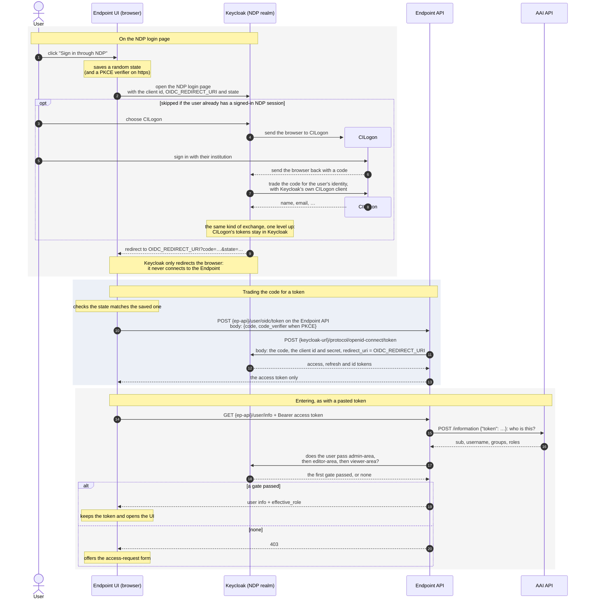

# Signing in through NDP

The optional "Sign in through NDP" button on the login screen, for users who
come through CILogon, ORCID and the other providers of the NDP realm and have
no password to type. It signs in with the Endpoint's own client,
`OIDC_SERVICE_CLIENT_ID`; its secret stays on the server.

Drawn against an Endpoint with `OIDC_ENABLED=True`, `OIDC_REDIRECT_URI` set and
the client's id and secret in `.env`. The settings are in
[../configuration.md](../configuration.md#identity-provider-sign-in-optional-off-by-default).

## The sequence

## Worth knowing

**Only the browser has to reach the Endpoint.** Keycloak sends the browser to
`OIDC_REDIRECT_URI`; it never connects to it. An Endpoint on a private address,
reached over a VPN, signs in the same way.

**The callback address is pinned.** The clients the Federation creates accept
any redirect URI. The API redeems codes for `OIDC_REDIRECT_URI` only, so a code
sent anywhere else cannot be redeemed with this Endpoint's secret. It must end
in `<ROOT_PATH>/ui/auth/callback`: the UI recognizes no other path as the
return from the login page, and the sign-in then ends quietly back on the login
card.

**Over plain http there is no PKCE.** Browsers compute it only on https and
`localhost`. A code that leaked on the way could then be redeemed by whoever
holds it, until the UI redeems it (at once) or it expires (one use, about a
minute). The access token crosses the network unencrypted anyway, as passwords
and pasted tokens do.

**Signing out leaves the NDP session open.** Other NDP sites stay signed in.
The next sign-in here sends `prompt=login`, so Keycloak shows its login form
instead of signing the same user straight back in. A 403 does the same, so the
user can try another account.
